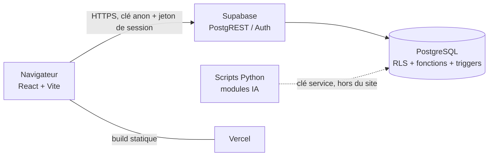

# 01. Architecture

## Vue d'ensemble

CONFERA est une application monopage (SPA) qui parle directement à une base Supabase. Il n'y a pas de serveur applicatif intermédiaire : la logique d'autorisation et les opérations sensibles vivent **dans la base** (policies RLS, fonctions SQL, triggers).



Pourquoi ce choix :

- **Une seule barrière de sécurité, au plus près des données.** Le navigateur n'est pas digne de confiance : n'importe qui peut appeler l'API Supabase avec la clé publique. Si les règles étaient dans le JavaScript, elles seraient contournables. Les règles sont donc écrites en SQL (voir [03 Sécurité](03-securite.md)) et le front ne fait qu'afficher ou masquer des boutons par confort.
- **Pas de serveur à maintenir.** Pour un projet de cette taille, Supabase fournit l'authentification, l'API REST et la base ; le site est un simple build statique hébergé sur Vercel.
- **L'IA reste en Python, hors du site.** Les modèles (Sentence-BERT, BERTopic, Qiskit) ne tournent pas dans un navigateur. Un script les exécute et écrit ses résultats dans des tables que le site lit (voir [06 IA](06-ia.md)).

## Pile technique

| Couche | Outil | Rôle |
|---|---|---|
| Interface | React 19 | Composants et état local |
| Build | Vite 8 | Serveur de développement, build de production, découpage du code |
| Styles | Tailwind CSS v4 | Utilitaires + système de design dans `src/index.css` (bloc `@theme`) |
| Icônes | Phosphor Icons | Jeu d'icônes unique, trait homogène |
| Données, authentification | Supabase (`@supabase/supabase-js`) | PostgreSQL, Auth, PostgREST, RLS |
| PDF | jsPDF | Certificat de participation, accusé de paiement (chargé à la demande) |
| QR code | qrcode, html5-qrcode | Génération du badge, scan à l'entrée des sessions (chargé à la demande) |
| Hébergement | Vercel | Déploiement à chaque push sur `main` |

## Organisation du code

```
src/
  main.jsx                 point d'entrée, application du thème avant le premier rendu
  App.jsx                  session, navigation entre les vues, en-tête et barre mobile
  index.css                système de design (tokens clair / sombre, composants CSS)
  lib/
    supabaseClient.js      client Supabase (clé anon uniquement)
    auth.js                contexte React : utilisateur, profil, admin
    constants.js           libellés, couleurs de statut, formats de date, slug
    errors.js              traduction des erreurs, détection des écritures refusées par la RLS
    theme.js               thème système / clair / sombre
    cover.js               couverture graphique déterministe d'un événement
  components/
    ui/                    briques d'interface réutilisables (Tabs, Pill, Avatar, Stat, EmptyState...)
    charts/Charts.jsx      graphiques faits main (barre empilée, barres, colonnes, ratio, tableau)
  features/
    auth/                  connexion, inscription, mot de passe oublié
    dashboard/             tableau de bord (à faire, mes événements, mes articles)
    events/                liste, fiche, création / modification, réglages, participants
    submissions/           articles : liste + détail, dépôt, resoumission, décision
    reviews/               formulaire de review
    sessions/              programme, sessions, salles
    registrations/         invitations, paiements, carte "Ma participation"
    attendance/            badge QR, pointage des présences
    certificates/          certificat et accusé de paiement (PDF)
    sponsors/              partenaires
    stats/                 statistiques d'un événement et de la plateforme
    profile/               profil de l'utilisateur
    admin/                 modération et administration
supabase-migrations/       scripts SQL numérotés, lancés à la main dans le SQL Editor
docs/                      cette documentation
```

Le code est découpé **par fonctionnalité** (`features/`) plutôt que par type technique : tout ce qui concerne les inscriptions est au même endroit, ce qui facilite la lecture et la maintenance.

## Navigation

L'application n'utilise pas de routeur. `App.jsx` garde dans son état la vue courante (`home`, `events`, `admin`, `profile`) et l'identifiant de l'événement ouvert. La fiche d'un événement accepte un onglet initial (`initialTab`), ce qui permet au tableau de bord et aux notifications d'ouvrir directement le bon onglet.

Limite assumée : pas d'URL par page (pas de lien partageable vers un événement, le bouton précédent du navigateur ne change pas d'écran). Ajouter `react-router` est une évolution simple si nécessaire.

## Flux de données

1. **Lecture** : chaque écran interroge Supabase avec `supabase.from(table).select(...)`. Les jointures (`profiles(full_name)`, `reviews(...)`) sont résolues par PostgREST grâce aux clés étrangères. La RLS filtre les lignes : un même appel renvoie des résultats différents selon l'utilisateur.
2. **Écritures simples** (créer une session, publier un sponsor) : `insert` / `update` / `delete` directs, autorisés par les policies.
3. **Écritures sensibles** (décision sur un article, invitation, paiement, validation, placement, pointage) : appel d'une **fonction SQL** (`supabase.rpc(...)`) qui vérifie les droits et fait toute l'opération d'un bloc (atomicité).
4. **Effets automatiques** : des triggers ajoutent le créateur comme organisateur, limitent à 2 les articles acceptés par auteur, refusent les conflits de salle et créent les notifications.

### Le piège des écritures silencieuses

Avec la RLS, un `UPDATE` ou un `DELETE` refusé **ne renvoie pas d'erreur** : il modifie simplement zéro ligne. Toutes les écritures du front ajoutent donc `.select('id')` et passent par `writeError()` (`src/lib/errors.js`), qui signale un refus quand la réponse est vide.

## Performances

- Le PDF (jsPDF, ~400 Ko) et le scanner QR (~370 Ko) sont chargés **uniquement** quand on en a besoin (`import()` dynamique). Le JavaScript principal pèse environ 700 Ko (190 Ko compressé).
- La fiche d'un événement charge l'événement, ses membres et ses articles en parallèle (`Promise.all`) et n'affiche le squelette de chargement qu'au premier affichage, pas lors des rafraîchissements.
