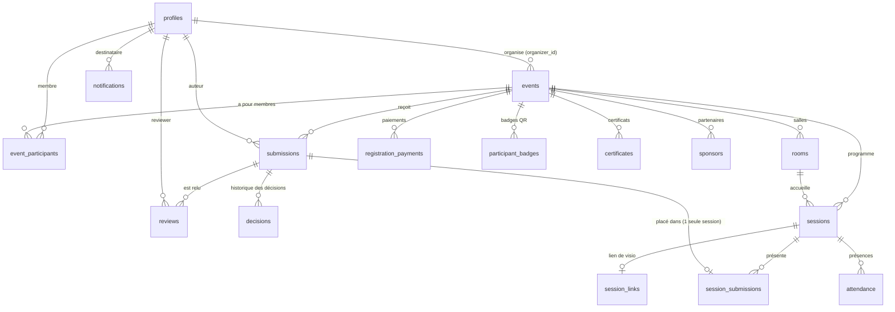

# 02. Modèle de données

Base PostgreSQL hébergée par Supabase, schéma `public`. Toutes les tables ont la **RLS activée**. Les identifiants sont des UUID.

## Principe : des rôles par événement

Un même compte peut être auteur dans un événement, reviewer dans un autre et organisateur d'un troisième. Les rôles ne sont donc **pas** stockés sur le compte mais dans `event_participants.role_in_event` (`organizer`, `reviewer`, `participant`). Seul le rôle d'**administrateur de la plateforme** est global : `profiles.role = 'admin'`.

## Diagramme entité-association (tables utilisées par le site)

## Tables

### Comptes et événements

| Table | Colonnes principales | Rôle |
|---|---|---|
| `profiles` | `id` (= `auth.users.id`), `full_name`, `email` (unique), `role` (`user_role`), `affiliation`, `country`, `expertise` | Profil public d'un compte. `expertise` sert au matching IA. |
| `events` | `title`, `description`, `type` (`event_type`), `status` (`event_status`), `phase` (`scientific` / `organizational`), `format` (`onsite` / `online` / `hybrid`), `start_date`, `end_date`, `location`, `organizer_id`, `registration_fee`, `payment_instructions` | Un événement et son état. |
| `event_participants` | `event_id`, `user_id` (unique ensemble), `role_in_event`, `registration_status` (`invited` / `payment_submitted` / `validated`), `invited_at`, `validated_at` | Appartenance d'un compte à un événement, avec son rôle et l'état de son inscription. |

### Phase scientifique

| Table | Colonnes principales | Rôle |
|---|---|---|
| `submissions` | `event_id`, `author_id`, `title`, `abstract`, `status` (`submission_status`), `submitted_at` | Un article soumis. |
| `reviews` | `submission_id`, `reviewer_id`, `score` (1 à 5), `comments`, `recommendation` (`accept` / `reject` / `revise`), `recommended_session_id` | Avis d'un reviewer. La session suggérée n'est permise que si la recommandation est `accept` (contrainte). |
| `decisions` | `submission_id`, `decided_by`, `status`, `revision_type` (`minor` / `major`), `decided_at` | Historique des décisions de l'organisateur (une ligne par décision, y compris les révisions successives). |

### Phase organisationnelle

| Table | Colonnes principales | Rôle |
|---|---|---|
| `rooms` | `event_id`, `name`, `capacity`, `location` | Salles disponibles. |
| `sessions` | `event_id`, `title`, `description`, `session_type` (`talk` / `workshop` / `panel`), `start_time`, `end_time`, `max_capacity`, `room_id` | Créneaux du programme. |
| `session_links` | `session_id` (clé), `url` | Lien de visioconférence, séparé de `sessions` pour n'être lisible que par les membres. |
| `session_submissions` | `session_id`, `submission_id` (unique), `presentation_order` | Placement définitif d'un article accepté dans une session. |
| `registration_payments` | `event_id`, `user_id` (unique ensemble), `reference`, `amount`, `declared_at`, `validated_at`, `validated_by` | Paiement déclaré par un invité (référence du bordereau), puis validé par l'organisateur. Séparé de `event_participants` parce que cette dernière est lisible par tous les connectés. |
| `participant_badges` | `event_id`, `user_id`, `token` (UUID unique) | Jeton personnel encodé dans le QR code (un seul badge pour toutes les sessions). |
| `attendance` | `event_id`, `session_id`, `profile_id`, `checked_in_at`, `method` (`qr` / `manual`) | Présence d'une personne à une session (unique par session et personne). |
| `certificates` | `event_id`, `user_id` (unique ensemble), `issued_at` | Trace de délivrance du certificat. |
| `sponsors` | `event_id`, `name`, `tier`, `website`, `benefits`, `published` | Partenaires, visibles du public seulement une fois publiés. |
| `notifications` | `recipient_id`, `event_id`, `type`, `title`, `message`, `sent_at`, `read_at` | Notifications internes, créées par des triggers. |

### Tables prévues pour l'IA (remplies plus tard par les scripts Python)

| Table | Colonnes | Contenu attendu |
|---|---|---|
| `reviewer_matches` | `submission_id`, `reviewer_id`, `similarity_score`, `method` | Affectations reviewer-article proposées par le matching |
| `topic_clusters` | `event_id`, `label`, `keywords`, `method` | Thèmes découverts par BERTopic |
| `submission_topics` | `submission_id` (unique), `cluster_id` | Thème de chaque article |
| `schedule_slots` | `event_id`, `cluster_id`, `room_id`, `start_time`, `end_time`, `assigned_by` | Créneaux proposés par l'optimisation QUBO / QAOA |
| `plagiarism_flags` | `submission_id_1`, `submission_id_2` (ordonnés), `similarity_score`, `status` | Paires d'articles suspects |

### Tables héritées, non utilisées

`payments` (ancien paiement simulé, accès fermé par la migration 001), `session_participants`, `logistics_resources`, `event_evaluations`. Certaines colonnes ne sont pas utilisées non plus : `events.is_online` (remplacé par `format`), `events.submission_deadline`, `submissions.file_url`, `sessions.chair_id`, et la valeur `under_review` de `submission_status`.

## Énumérations

| Type | Valeurs |
|---|---|
| `user_role` | `admin`, `organizer`, `reviewer`, `participant` |
| `event_type` | `conference`, `colloquium`, `seminar`, `workshop` |
| `event_status` | `draft`, `pending_approval`, `published`, `ongoing`, `closed`, `archived` |
| `submission_status` | `submitted`, `under_review` (inutilisé), `accepted`, `rejected`, `revision_requested` |

Piège connu : écrire dans une colonne de type énuméré depuis une fonction PL/pgSQL demande un cast explicite (`p_status::submission_status`).

## Contraintes métier portées par la base

| Règle | Mécanisme |
|---|---|
| Une personne n'appartient qu'une fois à un événement | `UNIQUE (event_id, user_id)` sur `event_participants` |
| Un article n'est placé que dans une seule session | `UNIQUE (submission_id)` sur `session_submissions` |
| Score de review entre 1 et 5 | `CHECK` |
| Session suggérée seulement si la recommandation est "accepter" | `CHECK reviews_session_only_if_accept` |
| Une présence par personne et par session | `ON CONFLICT (session_id, profile_id)` dans `check_in_member` |
| Au plus 2 articles acceptés par auteur et par événement | trigger `trg_max_accepted_per_author` |
| Pas deux sessions dans la même salle au même moment | trigger `trg_check_session_room` |
| Fin d'une session après son début | `CHECK sessions_time_order` |
| Lien de visio en `http(s)` | `CHECK` sur `session_links.url` |
