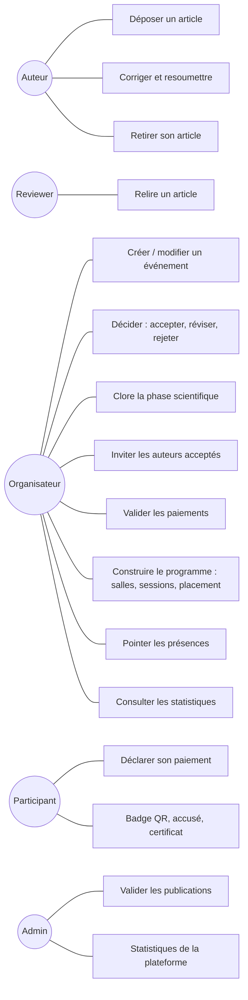
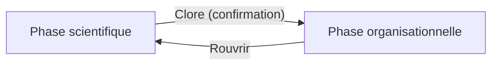
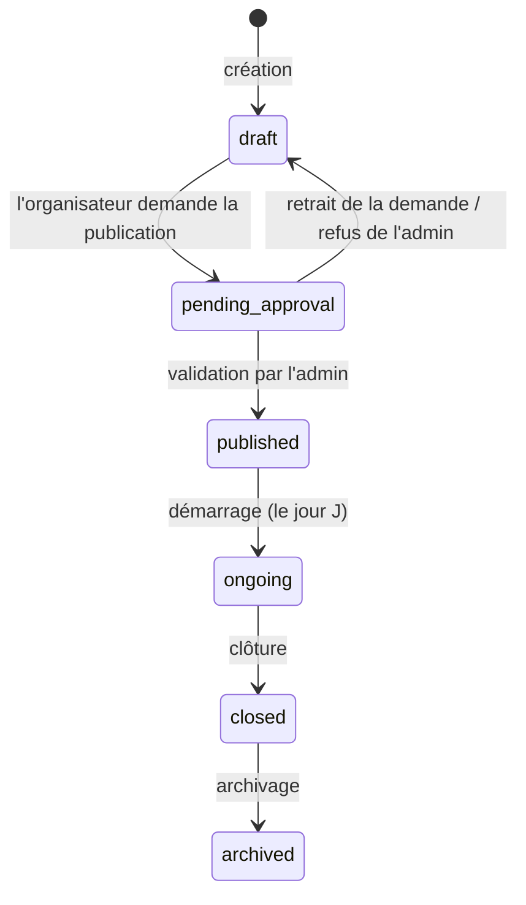
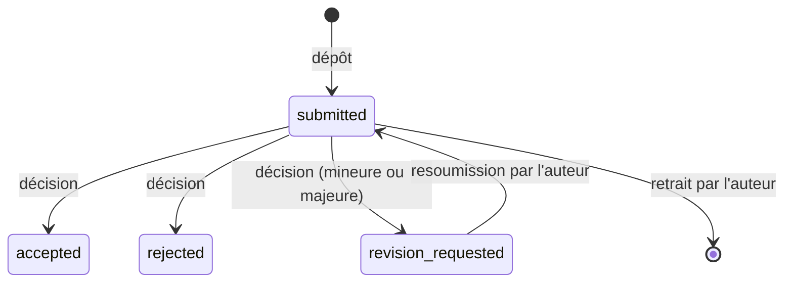
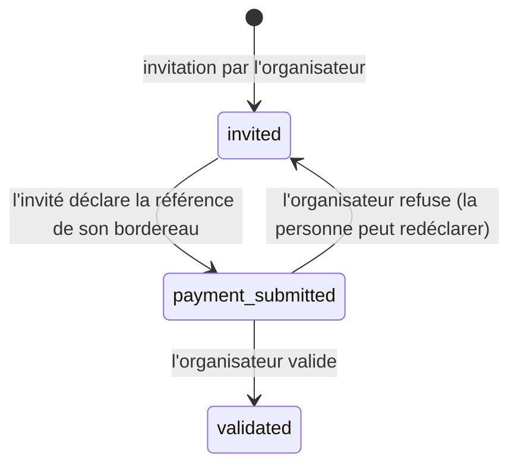

# 04. Fonctionnalités et règles métier

## Acteurs

| Acteur | Qui | Ce qu'il fait |
|---|---|---|
| Visiteur | Personne non connectée | Crée un compte, se connecte, réinitialise son mot de passe |
| Auteur | Tout compte connecté | Dépose des articles, suit leur évaluation, corrige et resoumet |
| Reviewer | Ajouté par l'organisateur | Relit les articles d'un événement : note, recommandation, commentaire |
| Organisateur | Créateur d'un événement ou co-organisateur | Gère l'événement, décide, invite, valide les paiements, construit le programme, pointe les présences |
| Participant | Auteur accepté invité par l'organisateur | Règle les frais, reçoit badge QR, accusé de paiement et certificat |
| Administrateur | `profiles.role = 'admin'` | Valide les publications, supervise et modère la plateforme |

Un même compte cumule ces rôles d'un événement à l'autre (voir [02 Données](02-donnees.md)).

## Cas d'utilisation

## Les deux phases d'un événement

L'encadrante a demandé une structure en deux phases. Elle est portée par la colonne `events.phase` et contrôlée par la base (`event_in_scientific_phase`).

| | Phase scientifique | Phase organisationnelle |
|---|---|---|
| But | Sélectionner les travaux | Préparer l'événement |
| Permis | dépôt, review, décision, révision et resoumission | invitations des participants, paiements, placement des articles dans les sessions, pointage |
| Gelé | invitations de participants, placement définitif | dépôt, review, décision, resoumission |

La clôture est **réversible** : l'organisateur peut rouvrir la phase scientifique (relancer des reviews, traiter une resoumission).

## Machines à états

### Événement (`events.status`)

Seules ces transitions sont acceptées pour un organisateur (trigger `guard_event_changes`). L'admin peut tout faire. Un brouillon n'est visible que de son organisateur et de l'admin.

### Article (`submissions.status`)

Chaque décision ajoute une ligne dans `decisions` (historique complet, y compris plusieurs révisions successives). Une décision n'est possible que sur un article en attente : l'interface demande une confirmation et prévient qu'acceptation et rejet sont définitifs.

### Inscription (`event_participants.registration_status`, rôle `participant`)

## Règles métier

| Règle | Où elle est appliquée |
|---|---|
| L'inscription n'est pas libre : seuls les auteurs acceptés sont invités (les reviewers sont ajoutés par e-mail à tout moment) | `invite_member` |
| Au plus 2 articles acceptés par auteur et par événement | trigger + bouton "Accepter" désactivé |
| Un reviewer ne relit ni son propre article, ni deux fois le même | trigger `guard_review_insert` + interface |
| Les commentaires des reviewers sont transmis anonymement à l'auteur | interface ("Reviewer 1, 2...") ; voir les risques résiduels dans [03](03-securite.md) |
| Un article accepté est placé dans une seule session ; la suggestion majoritaire des reviewers est préremplie | contrainte unique + `assign_submission_to_session` |
| Pas deux sessions dans la même salle au même moment | trigger `check_session_room` + avertissement avant l'envoi |
| Le badge QR est unique et valable pour toutes les sessions ; il n'existe pas pour un événement en ligne | `get_my_badge`, `participant_badges` |
| Le certificat n'est disponible qu'à partir du premier jour de l'événement, et seulement pour un inscrit validé | interface + policy `certificates_insert_own` |
| Les liens de visioconférence ne sont visibles que des membres | table `session_links` + `is_event_member` |
| Les sponsors en brouillon ne sont pas visibles du public | policy `sponsors_select` |

## Parcours complet

1. **Organisateur** : crée l'événement (brouillon), le complète, demande sa publication.
2. **Admin** : reçoit une notification, publie (ou renvoie en brouillon).
3. **Organisateur** : ajoute les reviewers par e-mail, fixe les frais et les modalités de paiement, crée les salles et les sessions.
4. **Auteurs** : déposent leurs articles (titre, résumé).
5. **Reviewers** : notent (1 à 5), recommandent (accepter, réviser, rejeter), commentent, suggèrent une session.
6. **Organisateur** : décide pour chaque article. En cas de révision, l'auteur voit les commentaires anonymes, corrige et resoumet.
7. **Organisateur** : clôt la phase scientifique, invite les auteurs acceptés (en une fois), place chaque article dans une session.
8. **Participants** : règlent les frais, déclarent la référence du bordereau.
9. **Organisateur** : valide ou refuse chaque paiement.
10. **Participants validés** : récupèrent badge QR, accusé de paiement, puis certificat.
11. **Jour J** : l'organisateur démarre l'événement et pointe les présences (scan du badge ou à la main) ; en ligne, les membres rejoignent les sessions par le lien de visio.
12. **Après** : clôture, statistiques, archivage.

## Écrans

| Écran | Contenu |
|---|---|
| Connexion | connexion, création de compte, mot de passe oublié, nouveau mot de passe |
| Tableau de bord | date, chiffres clés, prochain rendez-vous (compte à rebours), "À faire" calculé selon les rôles, mes événements, mes articles |
| Événements | événement à la une, recherche, filtres (tous, mes événements, publiés), à venir / passés, création |
| Fiche d'un événement | en-tête avec couverture et phase ; onglets Aperçu, Scientifique, Programme, Organisation, Statistiques |
| Scientifique | articles en liste + détail, filtres et recherche, étiquettes "À décider / À relire / À corriger", décision, review, resoumission |
| Programme | frise par jour, salle, places, session en cours, lien "Rejoindre", articles présentés, placement |
| Organisation | Événement (infos, publication, cycle de vie, phase), Participants, Inscriptions, Salles, Sponsors, Présences |
| Statistiques (événement) | taux d'acceptation, répartition des statuts, avancement et notes des reviews, dépôts par jour, entonnoir d'inscription, revenus validés, présences par session |
| Mon profil | nom, affiliation, pays, domaines d'expertise |
| Notifications | cloche dans l'en-tête, non lues, lien vers l'événement concerné |
| Administration | demandes de publication, tous les événements, statistiques de la plateforme |
