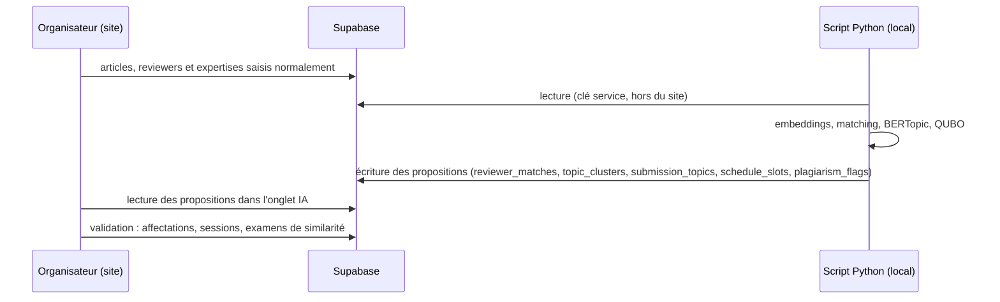

# 06. Intelligence artificielle

Les modules d'IA sont développés en **Python** dans le dossier `ai/` (hors du dépôt web), sous forme de notebooks Jupyter. Ils ne sont **pas encore branchés** au site. Ce document décrit ce qui existe, les résultats obtenus, les points à fiabiliser avant le mémoire, et la conception retenue pour l'intégration.

> Règle du projet : les algorithmes ne sont jamais réimplémentés en JavaScript. Le site **lit** des résultats produits par les scripts Python et validés par un organisateur.

## Jeu de données

`ai/submissions_arxiv.json` : **163 articles arXiv** dédupliqués (titre, résumé, catégorie réelle), répartis en 4 catégories : cs.AI (50), cs.CV (44), cs.CL (37), cs.LG (32). La catégorie réelle sert de vérité terrain pour évaluer le clustering.

## Module 1 : matching reviewer-article (`matching.ipynb`)

**Objectif** : proposer à chaque article les reviewers les plus compétents, sans surcharger personne.

**Méthode** :

1. Encodage des textes avec Sentence-BERT multilingue `paraphrase-multilingual-MiniLM-L12-v2` (vecteurs de dimension 384). Le notebook montre pourquoi le modèle multilingue est retenu : un même sujet en français et en anglais reste proche, contrairement à `all-MiniLM-L6-v2`.
2. Texte d'un article = titre + résumé ; texte d'un reviewer = description de ses domaines d'expertise.
3. Matrice de similarité cosinus articles × reviewers.
4. Affectation **gloutonne** sous contraintes : 2 reviewers par article, capacité maximale par reviewer ; les articles "difficiles" (meilleur score le plus faible) sont servis en premier pour ne pas hériter des restes.

**Sortie** : `matching_results.csv` (`soumission_idx`, `reviewer_idx`, `score`), 326 lignes = 163 articles × 2 reviewers ; similarité de 0,17 à 0,63 (moyenne 0,39).

**À fiabiliser avant le mémoire** :

- Les reviewers sont 8 profils **fictifs** écrits à la main. Pour l'intégration, l'expertise viendra du champ `profiles.expertise` (ajouté par la migration 002, saisi dans "Mon profil").
- Le CSV ne respecte pas la capacité de 3 articles par reviewer affichée dans le notebook (charges observées de 12 à 60 articles) : il a été produit par une autre version du code. Il faut régénérer le fichier avec le code présenté, ou présenter le code qui l'a réellement produit.
- Le notebook importe `linear_sum_assignment` (algorithme hongrois) sans l'utiliser : c'est une bonne base de comparaison (optimum global contre glouton) à ajouter.
- La dernière cellule appelle une variable mal orthographiée (`assignation` au lieu de `assignations`).

## Module 2 : clustering thématique (`clustering.ipynb`)

**Objectif** : regrouper les articles par thème pour construire les sessions.

**Méthodes comparées** :

| Méthode | Principe | Réglages |
|---|---|---|
| LDA (référence) | Modèle probabiliste sur sacs de mots | 4 thèmes, `max_df=0.5`, `min_df=3` |
| BERTopic | Embeddings Sentence-BERT, réduction UMAP (5 dim.), regroupement HDBSCAN, mots-clés c-TF-IDF | `min_cluster_size=8`, `min_samples=3` |

**Évaluation** : indice de Rand ajusté (ARI) entre les thèmes trouvés et les 4 catégories arXiv. Valeurs **enregistrées dans le notebook** : **BERTopic 0,20** contre **LDA 0,02**. BERTopic sépare nettement mieux les sujets ; LDA est proche du hasard sur des résumés courts.

**À fiabiliser avant le mémoire** :

- Les chiffres annoncés jusqu'ici (0,26 contre 0,03) ne correspondent pas à la sortie enregistrée (0,20 contre 0,02). UMAP et HDBSCAN sont sensibles à l'aléa et au matériel (GPU) : il faut fixer les graines, relancer plusieurs fois et donner **une moyenne et un écart-type**.
- La sortie enregistrée (6 thèmes, 7 documents "bruit") ne correspond pas à `clustering_results.json` (5 thèmes, 28 documents "bruit") : le fichier vient d'une autre exécution.
- La fonction `top_mots_topic` est utilisée sans être définie : le notebook ne se réexécute pas de haut en bas.
- Le code qui écrit `clustering_results.json` et `embeddings_submissions.npy` n'est pas dans le notebook.
- Les documents "bruit" (thème -1) doivent être traités explicitement dans le calcul de l'ARI (les garder comme une classe, ou les exclure et le dire).

## Module 3 : planification des sessions par QUBO et QAOA (`qubo.ipynb`)

**Objectif** : placer des sessions thématiques dans des créneaux en minimisant les conflits.

**Modèle** :

- 4 sessions (les 4 plus gros thèmes de BERTopic) et 2 créneaux, soit 8 variables binaires `x[s,t]` (la session `s` est dans le créneau `t`).
- Contrainte : chaque session dans exactement un créneau.
- Coût : pour deux sessions dans le même créneau, on paie un poids = conflit "reviewer" (reviewers partagés, tiré du matching) + 500 × conflit "thématique" (similarité cosinus des centroïdes de thèmes). Le facteur 500 compense la différence d'échelle entre les deux termes.
- Conversion en QUBO (`QuadraticProgramToQubo`, contraintes transformées en pénalités).

**Résolution comparée** :

| Solveur | Résultat | Temps |
|---|---|---|
| Exact classique (`NumPyMinimumEigensolver`) | optimum 1642,45 | 0,009 s |
| QAOA (p = 2, COBYLA 200 itérations, simulateur) | optimum trouvé **9 fois sur 10** ; l'essai raté donne 1766,66 | 47,6 s en moyenne |

**Interprétation honnête** : à cette taille (8 variables), le solveur exact est environ 5 000 fois plus rapide. L'intérêt de QAOA est **méthodologique** (formuler la planification comme un QUBO, compatible avec du matériel quantique ou des recuits) et non une accélération. La perspective est de montrer à quelle taille le solveur exact devient impraticable (2^n états) et de comparer à des heuristiques classiques (recuit simulé, Tabu).

**Sortie** : `qubo_results.json` (thème → créneau) et `qaoa_distribution.png` (distribution des 10 essais).

## Module 4 : détection de similarité (plagiat)

Annoncé dans le cahier des charges, **aucun notebook n'existe encore** dans `ai/`. Approche naturelle, réutilisant les embeddings du module 1 : similarité cosinus entre paires d'articles d'un même événement, seuil à calibrer, paires au-dessus du seuil écrites dans `plagiarism_flags` pour examen par l'organisateur (jamais de rejet automatique).

## Conception de l'intégration au site

Principes :

1. **Un script `ai/sync_supabase.py`** (bibliothèque `supabase-py`) lit les données d'un événement, exécute les modules et écrit les résultats. La clé `service_role` reste dans un `.env` du dossier `ai/`, jamais dans le site.
2. **Identifiants réels** : les notebooks travaillent sur des indices (`soumission_idx`, `reviewer_idx`) ; le script garde la correspondance avec les UUID de la base.
3. **Propositions, pas décisions** : les tables d'IA contiennent des propositions. L'organisateur les accepte ou les écarte dans le site ; rien n'est appliqué automatiquement (par exemple, une affectation acceptée ajoute le reviewer à l'événement par `invite_member`).
4. **Traçabilité** : chaque exécution note le modèle, les paramètres et la date (colonnes `method` déjà présentes ; un identifiant d'exécution est à ajouter), pour pouvoir citer exactement ce qui a produit un résultat.
5. **Lecture seule côté site** : un onglet "IA" dans Organisation affiche les propositions (reviewers proposés par article avec leur score, thèmes et mots-clés, planning proposé, paires similaires).
6. **Policies** : lecture des tables d'IA réservée aux organisateurs de l'événement ; aucune écriture depuis le site hormis le statut de validation.

## Prérequis déjà en place dans le site

- Champ `profiles.expertise`, saisi dans "Mon profil" (migration 002).
- Salles et sessions avec horaires (pour transformer un planning proposé en sessions réelles).
- Tables d'IA présentes dans la base (vides, RLS activée sans policy, donc fermées).
